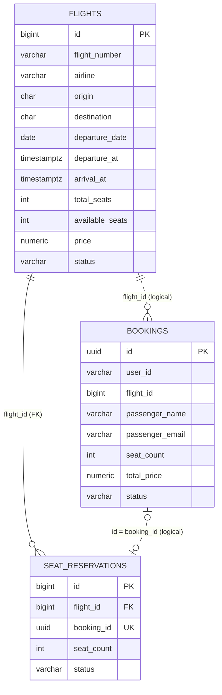
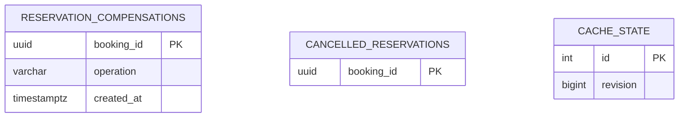

# ER-диаграмма — Flight Booking

## Физические и логические связи

- **`flight_db`**: `seat_reservations.flight_id` — настоящий внешний ключ на `flights.id`. Один рейс может иметь много резерваций.
- **`booking_db`**: `bookings.flight_id` логически указывает на `flights.id`, но PostgreSQL не создаёт внешний ключ между независимыми БД.
- `bookings.id` и `seat_reservations.booking_id` связывают запись заказа с резервированием через один UUID. Это **логическая связь** между сервисами.
- Пунктирные связи на схеме обозначают логические ссылки, сплошная — связь по внешнему ключу в `flight_db`.

## Ограничения целостности

| Таблица | Ограничения |
|---|---|
| `flights` | `id` — PK; `UNIQUE(flight_number, departure_date)`; `total_seats > 0`; `0 <= available_seats <= total_seats`; `price > 0`; `arrival_at > departure_at`; статус из набора `SCHEDULED`, `DEPARTED`, `CANCELLED`, `COMPLETED` |
| `seat_reservations` | `id` — PK; `flight_id` — FK; `booking_id` — `UNIQUE`; `seat_count > 0`; статус `ACTIVE`, `RELEASED`, `EXPIRED` |
| `bookings` | `id` — UUID PK; `seat_count > 0`; `total_price > 0`; статус `CONFIRMED` или `CANCELLED` |

**Нормализация:** данные о рейсе хранятся один раз в `flights`; данные пассажира и заказа — в `bookings`; количество зарезервированных мест и статус резервации — в `seat_reservations`. `total_price` в `bookings` намеренно фиксирует стоимость на момент покупки, чтобы дальнейшее изменение цены рейса не изменяло сумму уже созданного заказа.

## Служебные таблицы восстановления и кеша

- `reservation_compensations` находится в booking_db; operation — create или cancel.
  До начала резервирования сохраняется задача возврата мест. При успешной записи
  booking задача удаляется в той же транзакции. Для отмены задача хранится до её завершения.
- `cancelled_reservations` находится в flight_db. UUID — запрет позднего ReserveSeats
  после компенсации. Это служебная отметка, а не резервация мест; она может существовать
  без SeatReservation и не содержит данных рейса.
- `cache_state` находится в flight_db: единственная строка id=1 и положительная версия.
  Версия увеличивается атомарно с изменением мест. Данные рейсов в Redis — производные,
  Redis не является источником истины.
- Связь Booking–SeatReservation для успешно созданного booking — логическая 1:1.
  Во время компенсации может временно существовать резервация без booking.
- Служебные таблицы не дублируют атрибуты основных сущностей; их поля зависят от PK.
